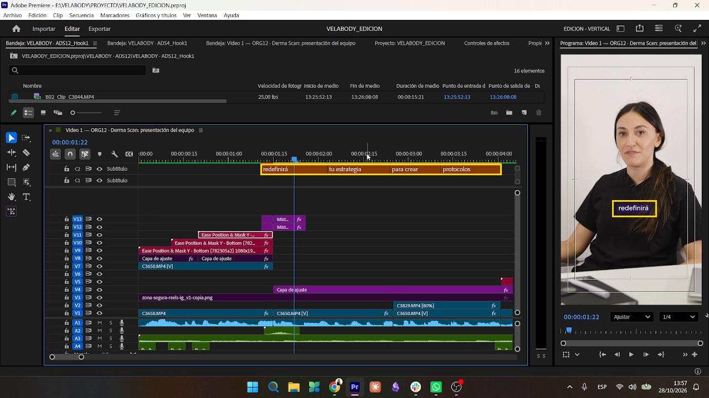
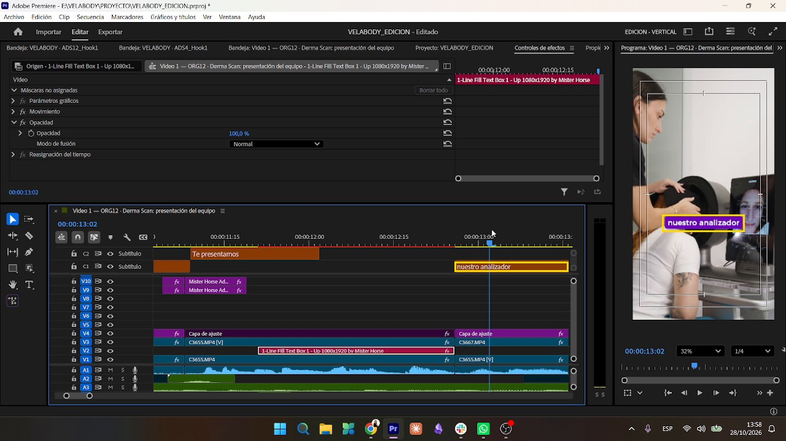

# Subtítulos

Todos los videos tienen que tener los subtítulos **igual que el Video 1** (feedback de la dueña del 27/10).

## Qué estilo va en cada plano

| Se ve en pantalla | Subtítulo |
|---|---|
| **B-roll** | **Con fondo** (caja violeta) |
| **La presentadora hablando a cámara** | **Con sombreado leve** violeta |

El color es **siempre `#6F04BA`**, tanto para el fondo como para el sombreado. **Sin excepciones.**

## Los dos estilos

| Estilo | Pista | Fuente | Tamaño | Aspecto | Largo máximo |
|---|---|---|---|---|---|
| `VELABODY SUBS C FONDO` (B-roll) | C1 | **Montserrat Medium** | **58** | Blanco sobre caja `#6F04BA` con las puntas redondeadas | **18 caracteres**, en **línea única** |
| `VELABODY SUBS CAMARA` (a cámara) | C2 | **Gotham Book** | **49** | Blanco con sombreado leve `#6F04BA` | 2 o 3 palabras, en una línea |

Fuentes confirmadas en Premiere el 30/10/2026 sobre `ADS13_Hook3`: "sugiere" (C1) y "tu propio catálogo" (C2).

## Reglas generales

- Pista de subtítulos **nativa** de Premiere.
- **Siempre una sola línea**, a **altura fija**. No van a mitad de cuadro ni tapan el equipo.
- El texto va **como se habla**, en minúsculas y con mayúscula solo al inicio de oración o en nombres propios. **No** se pasa todo a mayúsculas como en los títulos.
- Nunca se parten los nombres de producto: *Derma Scan*, *Diode Laser 4D*, *Infinity DPL*, *RF Cavi Pro*.
- Reemplazos automáticos: "láser" → "laser" y "Dermascan" → "Derma Scan".
- Si el plano cambia de B-roll a cámara en medio de una frase, el subtítulo cambia de estilo **en el corte**.

## Pendiente

- Las pistas se crean sin estilo: hay que aplicar a mano los estilos de pista (`VELABODY SUBS C FONDO` en C1 y `VELABODY SUBS CAMARA` en C2). El builder ya corta los de fondo a 18 caracteres.
- El builder v2 clona la secuencia del Video 1 y se trae sus **dos pistas de subtítulos viejas** (17 + 11 subs). Hay que borrarlas a mano porque ExtendScript no puede borrar pistas de subtítulos.
