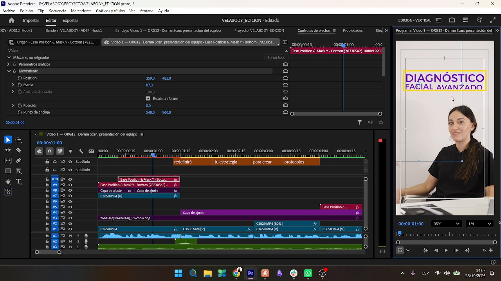
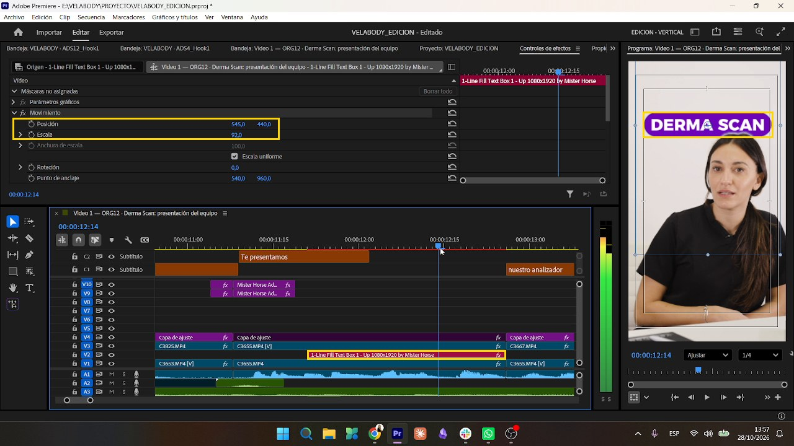

# Títulos y pastilla

Vigente desde el **28/10/2026** (estilo v2). Fuentes: las medidas tomadas del `.prproj` del Video 1 FINAL y la guía de gráficos.

> **Documento de referencia:** [Guia_graficos_Velabody.pdf](../_guia/Guia_graficos_Velabody.pdf) (también [en HTML](../_guia/guia_graficos.html)). Explica paso a paso cada gráfico, el sándwich de capas, la máscara y el rastreador, con fotogramas. **Leerlo antes de armar o corregir gráficos.**

## Cuántos y cuándo

Lo que muestran los [ejemplos aprobados](../04_ejemplos/README.md) (Videos 1 a 4):

- **De 2 a 4 gráficos por video**, no más. Un gráfico es para una **idea clave** o para el **producto**, no para cualquier frase. **Si el plan del video pide otra cantidad, manda el plan.** *(pedido del 30/10)*
- **El primero en el primer segundo**, con el gancho del video ("ANÁLISIS FACIAL", "4 PASOS", "FOTOTIPO").
- **El producto en pastilla**, muchas veces repetido en el cierre.
- Un video puede llevar **solo pastillas** (Videos 3 y 4). El paquetito se usa cuando la idea pide dos palabras (Video 2: "HERRAMIENTA / CLAVE").
- En los videos de listas o pasos no va un gráfico por paso: la estructura la dan la voz y los subtítulos.

## Reglas para todos los gráficos

- **Siempre en MAYÚSCULAS**: títulos, pastillas y nombres de producto, sin excepción. Los subtítulos no: esos van como se habla.
- **Los números van en cifras** en los gráficos: "CINCO COSAS" → "5 COSAS / QUE NO SABÍAS". En los subtítulos el número sigue escrito con letras ("cinco"). El builder lo convierte solo (`numeros_en_cifras`; "un", "uno" y "una" no se tocan porque casi siempre son artículos). *(pedido del 30/10, regla general)*
- **Siempre con margen justificado**, como en los ejemplos: todas las líneas tienen el mismo ancho, y la más larga toca los dos bordes de la guía. La línea corta se agranda (Video 2: "ANÁLISIS / FACIAL").
- **Siempre dos palabras, en dos líneas** (paquetito). Nunca una palabra sola ("RECOMENDACIÓN" → "RECOMENDACIÓN / CONCRETA", tomando la palabra que sigue en lo que dice) y nunca dos palabras en una sola línea ("ANALIZADOR FACIAL" → "ANALIZADOR / FACIAL", "PROTECTOR / SOLAR", "REPORTE / POR QR"). La palabra más corta se agranda hasta el mismo ancho. *(pedido del 30/10, revisión del ADS14)*
- **Si se corta la toma, el gráfico se corta en el mismo cuadro**: no queda un segundo, casi invisible, sobre la toma siguiente. *(pedido del 30/10)*
- **El título nunca toca la cabeza de la presentadora.** Si la toca, se sube el bloque (sin salir de la zona segura); si aun así no entra, se achica entero. *(pedido del 30/10)*
- **Cada gráfico entra con un click** (`Mouse Click.mp3`): títulos, pastillas, cada línea y cada vez que aparece, también si se reutiliza.
- **Fondo cargado** (cartelería, logos o texto detrás que dificultan la lectura). Se usa una de estas dos opciones:
  1. Una **sombra paralela leve** en el gráfico. Para empezar: opacidad ~40 %, distancia 4–6 px y suavidad 15–20, en negro o en violeta oscuro. Tiene que notarse que se lee mejor, no que tiene sombra.
  2. **Desenfocar un poco el fondo solo en la zona donde va el gráfico**, de forma orgánica: *Desenfoque gaussiano* (~15–25) con una máscara de calado grande, para que no se vea el borde del recorte.

  Los valores son un punto de partida y se ajustan a ojo hasta que se lea. Sobre el cartel "velabody" de la pared se prefiere el **desenfoque** detrás de las palabras. *(pedido del 30/10)*

## Título "paquetito"

| Dato | Valor |
|---|---|
| MOGRT | `Ease Position & Mask Y - Bottom (782305a2) 1080x1920` (Mister Horse, Starter Pack › Text Presets). Entra desde abajo con máscara. |
| Fuente | **Montserrat Medium**, todo en mayúsculas (botón TT), centrado. |
| Color | `#6F04BA` |
| Tamaño | En Propiedades: fuente 100 y escala ~100, **sin tocar**. El tamaño se ajusta en **Control de efectos › Movimiento › Escala** (entre 74 y 130 según la palabra). |
| Capas | **Una capa por línea.** La línea 2 entra **+0,3 s** después de la línea 1. |
| Sonido | Un *click* por cada capa (`Mouse Click.mp3`). |
| Duración | ~2,4 s |

### Cómo se arma

1. La palabra grande (DIAGNÓSTICO, TRATAMIENTO, TICKET…) tiene que **tocar los dos bordes** del rectángulo guía, que mide **852 px** de ancho.
2. Las otras líneas se escalan hasta que ocupen **ese mismo ancho**, aunque queden más grandes que la primera.
3. Alejarse y mirar: todo tiene que verse como **un bloque centrado**.
4. Solo **una variante de fuente por línea**. Si hacen falta dos pesos, se parte en dos líneas (DEPILACIÓN / LASER).
5. Como máximo 3 líneas.

> **Ojo:** si se sube la escala en *Propiedades*, el MOGRT corta los bordes. Todo el ajuste se hace en *Control de efectos*.

## Pastilla de destacado

Para nombres de equipo (DERMA SCAN, DIODE LASER 4D, RF CAVI PRO).

| Dato | Valor |
|---|---|
| MOGRT | `1-Line Fill Text Box 1 - Up 1080x1920` (Mister Horse) |
| Fuente | **Montserrat ExtraBold**, mayúsculas, **sin itálica**. Texto blanco. |
| Caja | `#6F04BA`. En Propiedades: Scale **285** y Round Corners **140**, **sin tocar**. |
| Posición | Control de efectos: **545 / 440** (arriba) y escala **72 a 92**. |
| Una sola vez | **Entra y sale una sola vez y se mantiene.** Si el plan la repite enseguida con el mismo texto (la reutilizada del cierre), sigue la primera; no hay una segunda entrada. *(pedido del 30/10)* |

### Pastilla detrás de la persona (sándwich)

Ver [transiciones y movimiento › sándwich de capas](transiciones_y_movimiento.md#sándwich-de-capas-pastilla-detrás-de-la-persona).

## Lo que ya NO se usa

- ~~Playfair Display Bold Italic~~ y el MOGRT viejo *Position & Mask Ease In [Bottom]* (1920x1080). Era el estilo de antes del 28/10.
- ~~Pastilla en itálica~~: la guía del 28/10 la muestra **sin itálica**.
- La propuesta de títulos de 4 opciones (`PROPUESTA_TITULOS`) quedó superada por la guía del 28/10.
