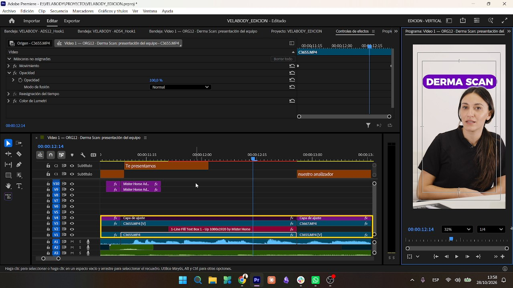
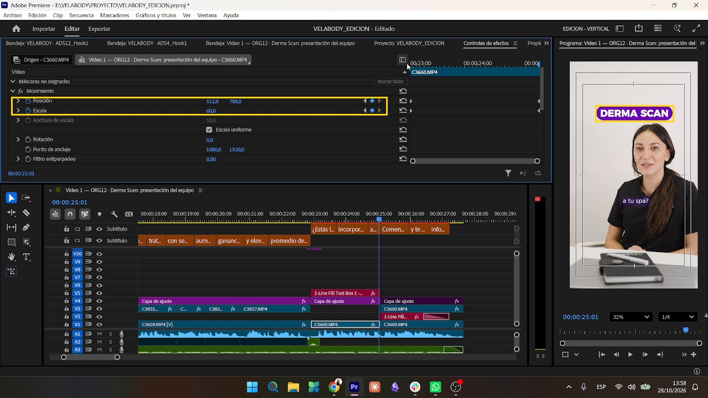

# Transiciones y movimiento

## Transiciones

- Usamos **Mister Horse "Pan Left"**, solo **2 o 3 por video**: del hook al cuerpo y entre bloques.
- Cada una lleva el SFX **`Transition Complex 14.wav`** **0,1 s antes** del corte, a −12 dB.
- **No usamos light leaks** (desde el feedback del 27/10, que pidió algo más tranquilo).
- La clienta pidió que en los videos ORG sean sutiles y en los ADS un poco más juguetonas.
- **Siempre la misma Pan Left**, con el mismo aspecto en todos los cortes *(pedido del 30/10)*. Medida en el Video 1 FINAL: la toma que sale apenas se corre a la izquierda en los 3 cuadros previos; la que entra aparece ~500 px a la derecha y frena en 9 cuadros, con desenfoque horizontal. Nunca se ve la imagen duplicada.

## A-roll (presentadora)

- Los clips vienen grabados **en vertical**. El archivo dice 3840x2160, pero trae `rotation=90`, así que el cuadro real es 2160x3840 y la escala base es **50**.
- **Zoom lento:** dos keyframes **lineales** (sin curvas automáticas) en Escala y Posición, de 50 a 56–60.
- **Punch-in** (~65) en los cortes por salto, para disimularlos.

## Sándwich de capas (pastilla detrás de la persona)

Así la pastilla queda detrás de la cabeza:

| Pista | Contenido |
|---|---|
| V1 | Clip original |
| V2 | Pastilla (`1-Line Fill Text Box`) |
| V3 | Copia del mismo clip con **Opacidad › Objeto máscara**, para que la persona quede por encima del gráfico |
| V4 | Capa de ajuste de Lumetri, **deshabilitada en ese tramo**. Se copia el *Color de Lumetri* y se pega en V1 y en V3, así la piel queda igual y el gráfico no se tiñe. |

Objeto máscara: calado ~13, opacidad 100 % y expansión 0 (se sube si detecta mal a la persona). Conviene dejar un **halo chiquito** alrededor, porque si no la máscara se come el gráfico cuando la persona se mueve. Si mueve mucho la cabeza, se usa el **Rastreador**, pero solo en tramos cortos porque consume mucha máquina.

## Reutilizar la pastilla con zoom

Cuando el mismo plano dura mucho, se vuelve a poner la pastilla **más chica y arriba** (545 / 350, escala de 72 a 80) y se le da un zoom-in suave al clip con dos keyframes lineales.

