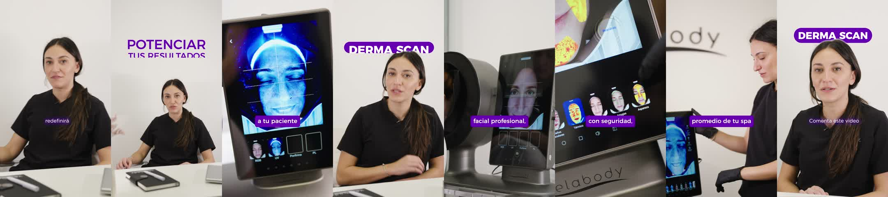

# Video 1 · ORG12 · Derma Scan: presentación del equipo (FINAL)

| | |
|---|---|
| Archivo | `E:\VELABODY\Video 1 — ORG12 · Derma Scan presentación del equipo\exportados\Video 1 — ORG12 · Derma Scan- presentación del equipo_FINAL.mp4` |
| Secuencia | `Video 1 — ORG12 · Derma Scan: presentación del equipo`. Es **la secuencia base que clona el builder v2**. |
| Duración | 27,7 s |
| Estado | **Referencia oficial de estilo** desde el 28/10/2026 |

*Un fotograma cada ~3,5 s.*

## Por qué es un buen ejemplo

- **~0:03 · Título paquetito** "POTENCIAR / TUS RESULTADOS": violeta, Montserrat Medium en mayúsculas, con la segunda línea escalada al ancho de la primera. Entra desde abajo con máscara.
- **~0:10 · Pastilla DERMA SCAN detrás de la cabeza** (sándwich de capas con Objeto máscara). Es el efecto más característico del estilo.
- **B-roll del equipo** con subtítulos en **caja violeta**, siempre en una línea y a la misma altura ("a tu paciente", "facial profesional,", "con seguridad,").
- **A cámara:** subtítulo blanco chico con brillo violeta, a la misma altura que los de B-roll.
- **~0:24 · Cierre:** CTA hablado ("Comenta este video") con la pastilla DERMA SCAN reutilizada arriba.
- Color parejo en todos los planos (Lumetri con la LUT Alexa).

## Reglas que ilustra

- [titulos](../../01_estilo/titulos.md): paquetito y pastilla.
- [subtitulos](../../01_estilo/subtitulos.md): los dos estilos a altura fija.
- [transiciones y movimiento](../../01_estilo/transiciones_y_movimiento.md): sándwich de capas y pastilla reutilizada con zoom.

## Qué copiar para el próximo video

- La secuencia entera es la plantilla: Lumetri, Pan Left y gráficos ya calibrados.
- Ojo con el audio: según el feedback del 27/10, este video había quedado más fuerte y cargado a la izquierda. **Eso no se copia.**
