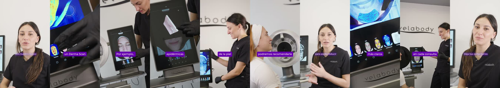

# Video 2 · ORG13 · Derma Scan: así es una consulta

| | |
|---|---|
| Archivo | `E:\VELABODY\_REFERENCIAS\ejemplos_aprobados\Video 2 — ORG13 - Derma Scan así es una consulta.mp4` |
| Duración | 39,4 s |
| Estado | **Ejemplo correcto** según Juli (30/10/2026) |

*Un fotograma cada ~4 s.*

## Por qué es un buen ejemplo

- **~0:01 · "ANÁLISIS / FACIAL"**: paquetito con las dos líneas **del mismo ancho**. La palabra corta va más grande, así que el bloque queda rectangular. Aparece apenas arranca el video.
- **~0:07 · "HERRAMIENTA / CLAVE"**: mismo criterio. La palabra importante (CLAVE) queda grande y la de apoyo, chica.
- **~0:24 · Pastilla "INFINITY DPL"**: cuando se nombra un equipo, va en pastilla y en mayúsculas.
- **Solo 3 gráficos en 39 s.** El resto lo sostienen el B-roll y los subtítulos.
- **Mucho B-roll del equipo en uso** (pantalla, cabina, la paciente): más o menos la mitad del video. Los subtítulos en caja violeta van siempre a la misma altura.
- **Cierre a cámara** con CTA ("Deja tus comentarios") en subtítulo blanco, sin gráfico.

## Reglas que ilustra

- [titulos](../../01_estilo/titulos.md): paquetito de 2 líneas con el mismo ancho, y pastilla para nombres de equipo.
- [subtitulos](../../01_estilo/subtitulos.md): los dos estilos a altura fija.

## Qué copiar para el próximo video

- El primer título en el **primer segundo**, como gancho.
- Pocos gráficos (3 o 4), cada uno para **una idea clave**, no para cualquier frase.
