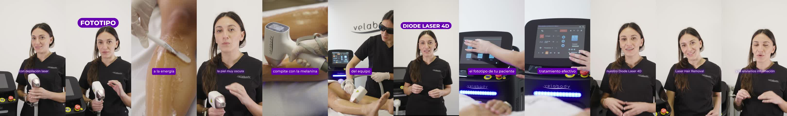

# Video 3 · ORG5 · Diode Laser 4D: por qué evaluar el fototipo

| | |
|---|---|
| Archivo | `E:\VELABODY\_REFERENCIAS\ejemplos_aprobados\Video 3 — ORG5 · Diode Laser 4D por qué evaluar el fototipo.mp4` |
| Duración | 54,1 s |
| Estado | **Ejemplo correcto** según Juli (30/10/2026) |

*Un fotograma cada ~4,5 s.*

## Por qué es un buen ejemplo

- **~0:06 · Pastilla "FOTOTIPO"**: el concepto clave del video va en pastilla, detrás de la cabeza (sándwich de capas).
- **~0:29 y ~0:53 · Pastilla "DIODE LASER 4D"**: el producto aparece a mitad del video y otra vez en el cierre, siempre en MAYÚSCULAS y en un solo bloque.
- **Solo pastillas, sin paquetito:** con 3 gráficos en 54 s alcanza.
- **Encuadres variados de la presentadora:** plano medio, primer plano y plano más abierto. Los saltos de encuadre (punch-in y zoom) disimulan los cortes y dan ritmo.
- **B-roll que muestra lo que se dice:** piel oscura con gel ("la piel muy oscura", "compite con la melanina"), la operadora con anteojos y la pantalla del equipo ("el fototipo de tu paciente").
- Subtítulos de una línea en los dos estilos, y "laser" **sin tilde** ("depilación laser").

## Reglas que ilustra

- [titulos](../../01_estilo/titulos.md): pastilla para concepto y para producto.
- [transiciones y movimiento](../../01_estilo/transiciones_y_movimiento.md): punch-ins y sándwich de capas.
- [reglas de la clienta](../../02_reglas_cliente.md): producto en mayúsculas y laser sin tilde.

## Qué copiar para el próximo video

- Si el video gira sobre un concepto técnico, ese concepto va en pastilla al principio.
- Repetir la pastilla del producto en el cierre.
