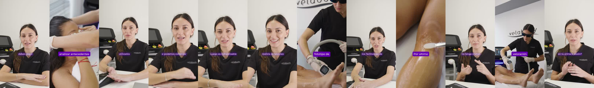

# Video 4 · ORG6 · Diode Laser 4D: 4 pasos antes de una sesión

| | |
|---|---|
| Archivo | `E:\VELABODY\_REFERENCIAS\ejemplos_aprobados\Video 4 — ORG6 · Diode Laser 4D 4 pasos antes de una sesión.mp4` |
| Duración | 50,4 s |
| Estado | **Ejemplo correcto** según Juli (30/10/2026) |

*Un fotograma cada ~4 s.*

## Por qué es un buen ejemplo

- **~0:01 · Pastilla "4 PASOS"**: el gancho del título del video aparece en el primer segundo.
- **~0:32 · Pastilla "DIODE LASER 4D"**: el producto, una sola vez y en mayúsculas.
- **Solo 2 gráficos en 50 s.** La estructura de "pasos" la marcan la voz y los subtítulos ("Luego es indispensable", "Por último"), no hacen falta más gráficos.
- **Cada paso tiene su B-roll:** antecedentes con la paciente, protección de ojos, pantalla del equipo, gel y la valoración con la operadora.
- **A-roll en dos tamaños** (plano medio y primer plano) que se alternan para dar ritmo en los tramos largos a cámara.
- Subtítulos de una línea a altura fija. Cierra con una pregunta a cámara ("¿…en tu primera sesión?").

## Reglas que ilustra

- [titulos](../../01_estilo/titulos.md): pastilla para gancho y producto.
- [subtitulos](../../01_estilo/subtitulos.md): una línea a altura fija.
- [transiciones y movimiento](../../01_estilo/transiciones_y_movimiento.md): alternar encuadres en vez de sumar gráficos.

## Qué copiar para el próximo video

- En los videos de "N pasos" o listas: **una** pastilla con el número al principio. No hace falta un gráfico por paso.
- Un B-roll distinto para cada paso.
